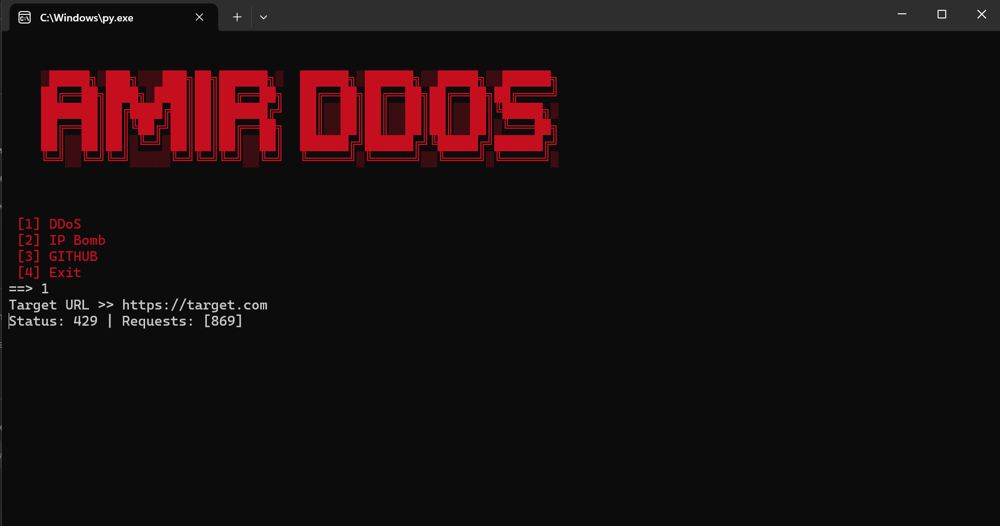

<h1 align="center">ADDoS</h1>
<div align="center">
**Educational DoS Tool**

A Python-based application for educational cybersecurity research and controlled laboratory environments.
</div>

<p align="center">
  
</p>

## Features

- Python-based application.
- Simple installation and launch.
- Educational cybersecurity testing in authorized environments.

## Installation

Clone the repository and enter the project directory:

```bash
git clone https://github.com/AmirCyberSecurity/ADDoS
cd ADDoS
```

Install dependencies:

```bash
pip install -r requirements.txt
```

## Run

Start the application:

```bash
python ADDoS.py
```

## Quick Start

Alternatively, use the launcher:

```bash
python launch.py
```

## Requirements

```text
aiohttp
colorama
pystyle
```

Python 3.x is required.

## Disclaimer

ADDoS is an educational project intended for cybersecurity learning and authorized testing in controlled environments.

Only use this application on systems you own or have explicit permission to test. The author is not responsible for misuse or damage caused by unauthorized use.

<div align="center">

**ADDoS - Educational Cybersecurity Project**

</div>
